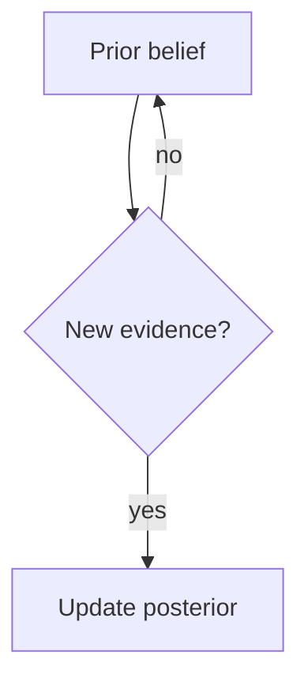

# rich-render

Write the answer as a rich HTML document served on localhost, instead of as
markdown in the terminal. The terminal gets a short summary and a link.

The renderer handles **LaTeX math** (KaTeX), **Mermaid diagrams**, GFM tables,
and code blocks. All assets are vendored locally — it works with no network.

---

## When to trigger

Apply these rules before writing a response. They are deliberately asymmetric:
math is eager, everything else is conservative.

### Always render — math

**Any answer containing LaTeX-worthy math renders. No threshold.** If you would
reach for a fraction, integral, summation, subscript, Greek letter, matrix,
expectation, or probability expression, it goes in a document. Terminal
markdown mangles all of it.

This covers: derivations, proofs, Bayes' theorem and posterior updates,
distributions and their parameters, statistics, linear algebra, optimization
objectives, loss functions, complexity analysis with real recurrences.

### Render when substantial — plans

Render an **implementation, migration, refactor, architecture, debugging, or
rollout plan** when it has roughly **four or more steps**, or when it has
phases, decision points, ordering constraints, or a dependency structure.

A two-step "install X, run Y" answer stays in the terminal.

### Render when substantial — diagrams

Render when a **Mermaid diagram carries real explanatory weight**: roughly
**four or more nodes**, or any branching, cycle, or multi-actor sequence.

Good fits: control and data flow, state machines, decision trees, causal /
Bayesian networks, request sequences, dependency and module graphs, ER
diagrams, gantt-style rollouts.

A single if/else stays in the terminal.

### Explicit override

"Render this", "show me that properly", "put that in a document", "make a
diagram of this" — render regardless of size. If the user asks for rendering
once, keep rendering related follow-ups for the rest of the conversation
without asking again.

### Do not trigger

- Short factual answers, definitions, single commands.
- Code edits, file writes, refactors — the diff is the deliverable.
- Debugging narration, test output, error triage.
- A lone inline symbol in otherwise plain prose (`O(n log n)`, `p < 0.05`).
- Anything the user asked to keep in the terminal.

When genuinely undecided, render. A stray tab costs the user one click;
mangled math costs them the answer.

---

## How to render

### 1. Start (or reuse) the server

```bash
python3 "${CLAUDE_PLUGIN_ROOT}/server/serve.py" start --project "$PWD"
```

Returns JSON: `port`, `url`, `urls`, `host`, `session_dir`, `doc_url_base`,
`reused_server`.

Idempotent and cheap — safe to call every time. It reuses a running server,
reuses the session directory for this project (within 12 hours), prunes
sessions older than 30 days, and picks the next free port if the default is
taken by something else. Default port 3001; override with `RICH_RENDER_PORT`
or `--port`.

The server binds `0.0.0.0` by default, so the documents are reachable from
other machines over VPN or LAN. **Report the `url` field verbatim** — it is the
hostname- or LAN-IP-based URL a remote viewer can actually open. Do not
substitute `localhost` or `127.0.0.1`; those are useless to anyone not sitting
at this machine. `urls` holds the alternatives, loopback last.

Remember `session_dir` and `doc_url_base` for the rest of the conversation so
later documents skip straight to step 2.

### 2. Write the document

Write a markdown file to `<session_dir>/<slug>.md` with the **Write tool**.

> **Use the Write tool, not a bash heredoc.** An unquoted heredoc eats `$` and
> backslashes, which destroys every formula in the file.

Slug: short, kebab-case, descriptive — `auth-migration-plan`,
`posterior-update`, `retry-state-machine`.

Front matter is required:

```markdown
---
title: Cache Invalidation Rollout
kind: plan
summary: Four-phase rollout, with the consistency risk at phase 3 and its guard.
---

## Phase 1 — shadow reads
...
```

- `title` — shown as the page heading and browser tab.
- `kind` — `plan`, `math`, `diagram`, `analysis`, or `doc`. Shown as a badge.
- `summary` — one line, shown under the title and on the index card.

Do not repeat the title as an `# H1`; it is rendered from front matter. Start
the body at `##`. Three or more `##`/`###` headings generate a sidebar table of
contents automatically.

### 3. Report back in the terminal

Two to five lines: the actual takeaway — the recommendation, the result, the
thing they need to know — then the URL. Never just the URL, and never the full
document.

```
Four phases; the consistency risk is concentrated in phase 3, guarded by a
shadow-read window before the cutover. Phases 1, 2 and 4 are reversible.

http://127.0.0.1:3001/doc/20260831-141203-myproject/cache-rollout
```

### Updating a document

Rewrite the same file. Open pages poll every 1.5s, re-render in place, keep
scroll position, and flash "Updated" — so a plan you revise updates live in an
already-open tab. Reuse the slug; only create a new file for a new topic.

---

## Authoring

### Math

`$inline$` or `\(inline\)`; `$$display$$` or `\[display\]` on their own lines.

Math is extracted before markdown parsing, so `$P(A_1 \mid B_2)$` keeps its
subscripts. Dollar signs inside backticks or fenced blocks are never treated as
math, so `` `$PATH` `` and `$5` are safe. Invalid LaTeX renders as inline red
text rather than breaking the page.

Prefer `\mid` over `|` in conditionals, and `\,` for thin spaces in integrals.

### Mermaid

Fence with `mermaid`:

````markdown

````

**Quote every node label** — `A["text"]`. Unquoted parentheses, colons, commas,
and quotes are the most common cause of a diagram failing to parse. For a
literal parenthesis inside a quoted label use the HTML entities `&#40;` and
`&#41;`. Keep labels under about six words. Diagrams re-theme automatically
when the reader toggles light/dark.

`flowchart`, `sequenceDiagram`, `stateDiagram-v2`, `erDiagram`, `classDiagram`,
`gantt`, `journey`, `pie`, `mindmap`, and `timeline` are all available.

### Everything else

GFM tables (wide ones scroll), task lists, blockquotes, nested lists, and code
fences all work. Code blocks are not syntax-highlighted — no highlighter is
vendored — so keep them short and illustrative.

---

## Interaction with plan mode

Plan mode's approval prompt is the user's decision point and must stand alone.

- Put the **full plan** in `ExitPlanMode` as usual. Do not replace it with a
  link — the user cannot approve a page they have to leave the terminal to read.
- Render the document **in addition**, when the plan is diagram- or math-heavy
  enough to benefit, and mention the URL alongside the plan.

## Notes

- The server binds `0.0.0.0` by default so a remote machine (VPN, LAN, a named
  server) can view the documents. Anyone who can reach the port can read every
  rendered document, so treat rendered content accordingly. Set
  `RICH_RENDER_HOST=127.0.0.1` to restrict it to this machine.
- Documents persist in `~/.claude/rich-render/sessions/`, grouped by project,
  pruned after 30 days. The index at `/` lists everything.
- Never auto-open a browser. Print the URL and let the user click.
- If `start` reports `"ok": false`, check the `log` path it names and fall back
  to plain terminal markdown rather than dropping the answer.
